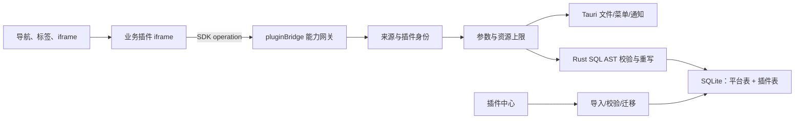

# Treasure 宿主架构

> 面向宿主维护者和需要扩展平台能力的高级工程师。业务插件作者应优先阅读 `treasure-plugins/docs/PLUGIN-DEVELOPMENT-GUIDE.md`；SDK 公开接口以 `treasure-sdk/docs/API-REFERENCE.md` 为准。

## 1. 系统边界

Treasure 是三个项目中的**桌面宿主和最终安全裁决点**。它负责插件安装、iframe 生命周期、能力授权、平台 SQLite、插件 SQL 命名空间、原生文件/菜单/通知以及平台 UI；不承载具体插件业务，也不向插件暴露 Tauri 或绝对路径。



三个仓库的契约关系：

| 仓库 | 权威内容 | 变更时必须联动 |
| --- | --- | --- |
| `treasure` | 宿主行为、安全策略、持久化与安装流程 | SDK operation、返回结构、插件模板和协议文档。 |
| `treasure-sdk` | 插件可使用的公开 TypeScript API | 宿主能力注册表、内置插件、迁移文档。 |
| `treasure-plugins` | manifest、迁移脚本和业务实现示例 | SDK 最低版本、宿主联调与发布检查。 |

## 2. 启动与运行时链路

1. `src/main.ts` 挂载 Vue、Element Plus、Pinia 和 Router。
2. `initPluginBridge()` 注册全局 `message` 监听，使已加载 iframe 可以请求能力。
3. `initDatabase()` 调用 Rust `db_run_migrations`；平台数据服务通过就绪门禁访问 SQLite。
4. Frame 从平台表加载菜单和标签。安装插件使用 `plugin://localhost/plugin/<pluginCode>/index.html`；调试插件使用登记的精确 HTTP origin。
5. iframe 上的 `data-treasure-plugin` 关联插件身份。桥接从 `MessageEvent.source` 查找 iframe，并校验调试 origin；不接受请求载荷自报身份。
6. 标签关闭时移除 iframe 并注销该插件的菜单注册。

`npm run dev` 只启动宿主前端，无法替代 Tauri 运行时。需要完整宿主能力时使用 `npm run tauri -- dev`。

## 3. 插件能力网关

`src/bridge/pluginBridge.ts` 的 `capabilityRegistry` 是宿主支持 operation 的单一清单。当前能力域包括 `files`、`directories`、`storage`、`database`、`settings`、`permissions`、`menus`、`notifications` 和 `logs`。

一条请求的裁决顺序：

```text
消息信封与 requestId
  → MessageEvent.source 对应已注册 iframe
  → 调试 origin / 安装协议来源校验
  → operation 存在且 payload 通过结构校验
  → 文件引用、目录引用、permissionKey 或 SQL 表声明校验
  → 资源上限校验
  → 原生能力或 Rust SQL 执行
  → Result<T> 回传到请求 origin
```

重要上限来自当前宿主源码：数据库请求载荷 256 KiB、事务最多 50 条、查询结果最多 1,000 行、单次文件或私有存储读写最多 32 MiB。修改这些值属于协议行为变更，必须同步 SDK API 参考和插件测试。

当前菜单能力存在一个需要保留在架构评审中的契约缺口：SDK 公开了 `menus.register/unregister`，但尚未公开类型化的菜单点击订阅或勾选状态更新 API；宿主目前以 `treasure-menu-event` 反向消息通知 iframe。已有内置插件仍直接监听该内部消息。新增第三方插件不应把该消息当稳定公共 API；完善菜单能力时应先在 SDK 定义事件订阅和生命周期语义，再迁移内置插件。

## 4. 数据与权限模型

### 4.1 平台数据与插件数据

- 平台迁移由 Rust 数据库层执行；Vue 侧不维护另一套平台 schema。
- 插件运行时 SQL 使用业务短表名，并为每条语句完整声明 `tables`。
- Rust 解析 SQL AST、核对表声明，并将短表名重写为 `plugin_<pluginCode>_<table>`；平台表不可访问。
- `query` 只用于查询，`execute` 只用于受控写入，`transaction` 对每条语句分别校验后原子提交。DDL 只允许出现在安装/升级迁移脚本。

### 4.2 文件与目录

- 用户通过系统对话框选择资源后，宿主签发不含路径的 `FileReference` 或 `DirectoryReference`。
- 引用只属于签发它的插件；会话引用不可伪造，也不应被插件持久化。
- 需要跨重启恢复根目录时，插件用稳定 `permissionKey` 调用 `permissions.grantDirectory/getDirectory`。子引用应从恢复后的根目录重新列举。
- `storage` 是插件私有数据区，只接受经过校验的相对键。它不同于用户选择的工作目录。
- 删除目录或目录内项目会移入系统回收站；卸载插件不得删除用户选择的外部目录。

## 5. 安装、升级与卸载

插件中心接受目录包、ZIP 包以及登记的调试地址。manifest 的 `name`、入口页 `treasure-plugin-code` 与安装身份必须一致；`minPlatformVersion` 阻止不兼容宿主加载。

插件 schema 通过 `scripts/init/<semver>.sql` 版本化演进。已发布迁移不可修改；升级只能新增更高版本脚本，并必须可重复检测和安全失败。`scripts/destroy.sql` 只处理插件自身数据库资源，私有存储由宿主清理，用户目录保持不变。

## 6. 可观测性与失败策略

- 宿主日志入口在 `src/utils/logger.ts`，Rust 侧日志配置和平台日志表由数据库服务管理。
- 桥接的业务失败转换为结构化 `Result`，插件不应依赖异常处理普通取消或权限失败。
- 数据库迁移失败是启动级故障；不得继续假定平台表可用。
- 文件引用过期、授权不存在和用户取消是可恢复分支；UI 应引导重新选择或安静结束。

## 7. 架构变更检查

新增或调整一项宿主能力时，至少完成：

1. 在宿主能力注册表定义 operation、结构校验、身份/授权规则与上限。
2. 在 Rust 或前端执行层实现最小原子能力，不暴露路径、物理表名或通用执行入口。
3. 在 `treasure-sdk/src/client.ts` 和公共导出中增加类型化 API，并补契约测试。
4. 更新桥接协议、API 参考、插件模板和至少一个真实使用场景。
5. 验证伪造身份、错误 origin、越权引用、超限输入、取消、超时与资源清理。
6. 执行宿主 `npm run typecheck && npm test && npm run build`，再在 Tauri 中完成真实联调。
